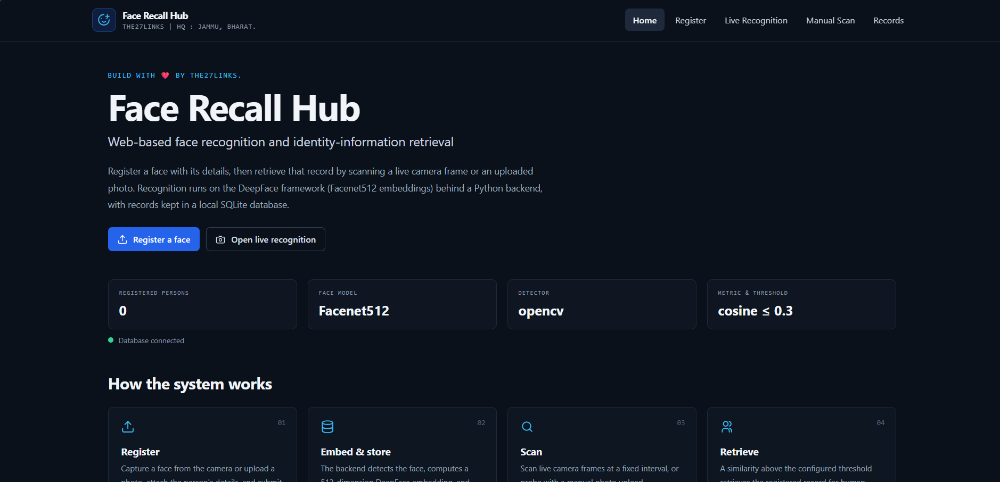
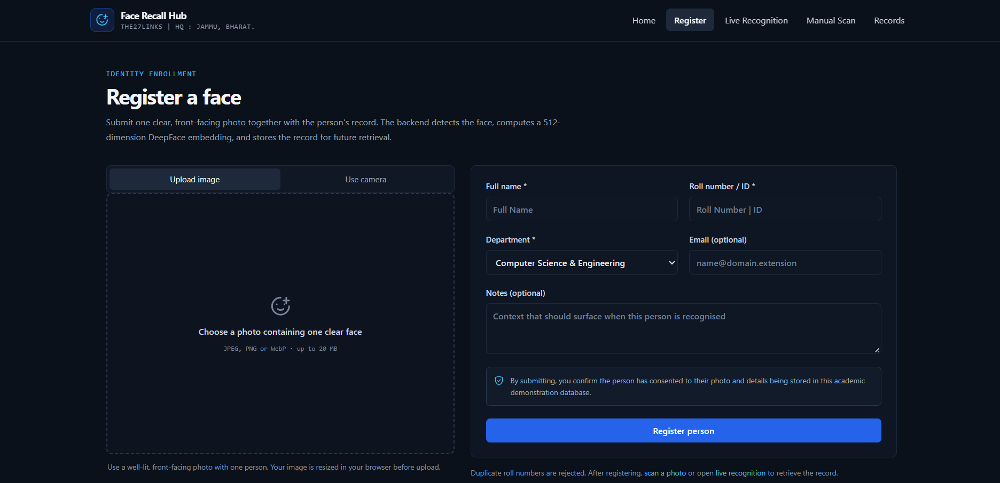
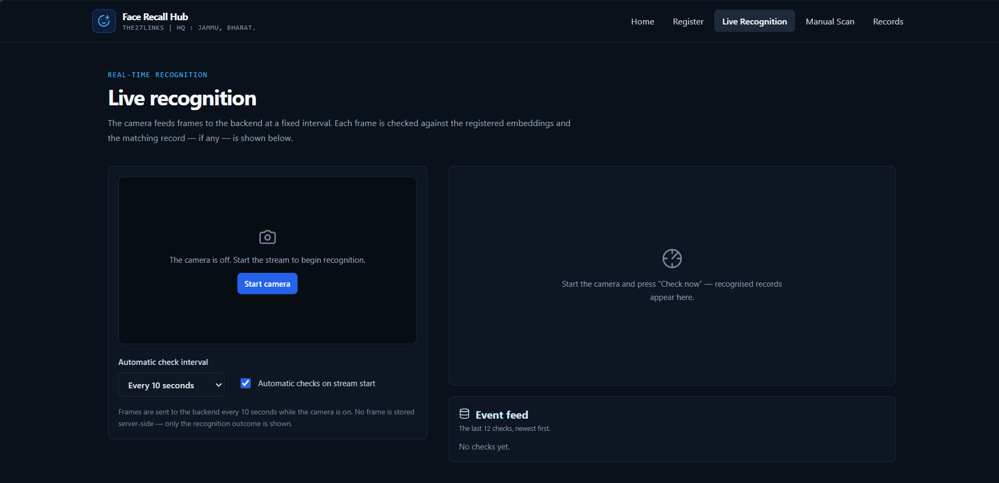
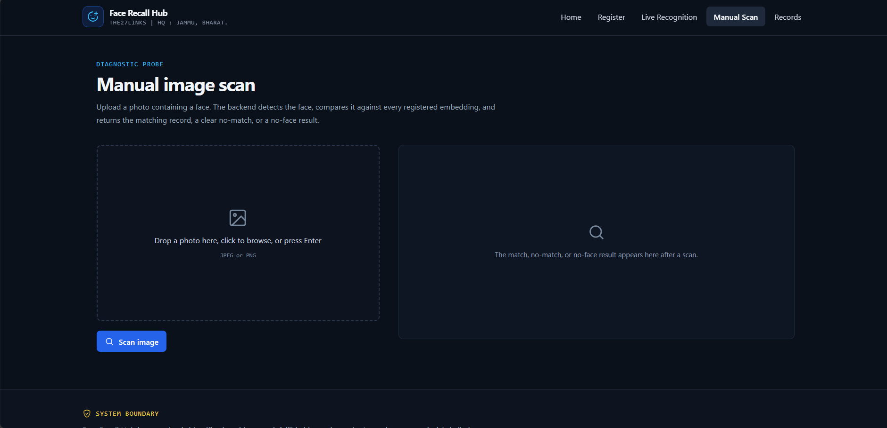
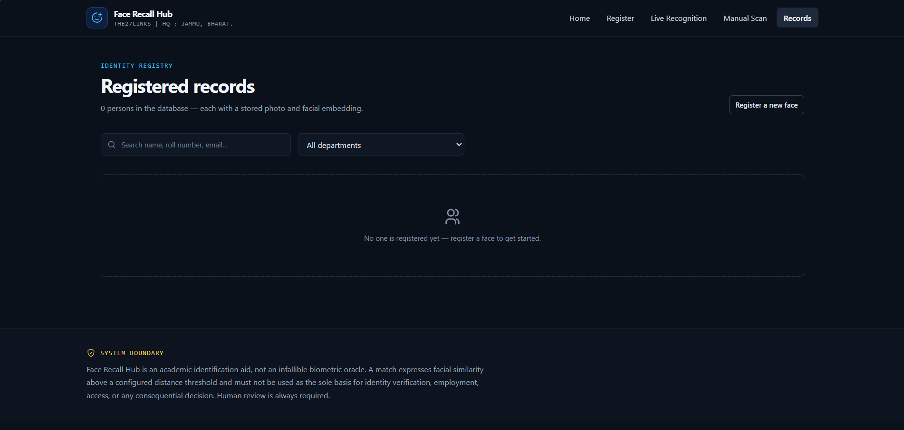

# Face Recall Hub

Face Recall Hub is a local academic demonstration of face-similarity matching
and identity-record retrieval. It has a single-file Python web server, a
SQLite database, and a plain HTML/CSS/JavaScript frontend. It does not require
Node.js, a frontend build step, a separate API server, or a MongoDB service.

> Face similarity is not proof of identity. Get consent for all stored photos
> and require human review. Do not use this academic demonstration as the sole
> basis for access, employment, law enforcement, or other consequential
> decisions.

## At a glance

| Component | Specification |
| --- | --- |
| Backend and static web server | Python 3.10 or newer; `backend\server.py`; Python standard-library HTTP server |
| Face analysis | DeepFace with Facenet512 embeddings and the OpenCV detector by default |
| Database | SQLite at `backend\data\face_recall_hub.sqlite3` by default |
| Frontend | Vanilla HTML, CSS, and JavaScript in `frontend\` |
| Default address | <http://127.0.0.1:8000> |
| Webcam | Optional; upload a photo if a camera is unavailable or permission is denied |
| Operating system | Windows instructions below; Python and SQLite are cross-platform |

## Project files

```text
FRH/
├── backend/
│   ├── server.py                 # Python HTTP server, API, face recognition and SQLite
│   ├── requirements.txt          # Python package requirements
│   ├── .env                      # Optional local settings (not committed)
│   ├── data/
│   │   └── face_recall_hub.sqlite3
│   └── tests/
│       └── test_server.py        # Database and API regression tests
├── frontend/
│   ├── index.html                # Application entry point
│   ├── styles.css                # Responsive dark interface
│   └── app.js                    # Pages, camera, forms and API calls
├── .env.example                  # Example server/model/database settings
├── .gitignore
└── README.md
```

On first launch, DeepFace may download its face-model weights. This can take
several minutes and requires an internet connection. The server reports whether
model initialization succeeds in the terminal. Wait for `Face model ready` to
appear before registering or scanning faces.

## Run on Windows

Open PowerShell in the project folder, the folder containing this `README.md`.
Create the environment and install the required packages:

```powershell
py -3 -m venv .venv
.\.venv\Scripts\python.exe -m pip install --upgrade pip
.\.venv\Scripts\python.exe -m pip install -r backend\requirements.txt
```

Skip the `venv` command if `.venv` already exists. Start the complete app with:

```powershell
.\.venv\Scripts\python.exe backend\server.py
```

Keep this terminal open and wait for a message similar to:

```text
INFO face_recall_hub: SQLite database ready at ...\backend\data\face_recall_hub.sqlite3
INFO face_recall_hub: Face Recall Hub listening at http://127.0.0.1:8000
INFO face_recall_hub: Face model ready: Facenet512
```

Open **<http://127.0.0.1:8000>** in the browser. Use the address printed by the
Python server: a preview URL or another port (for example, `8766`) does not
serve the API and will cause registration to fail. Stop the app with `Ctrl+C`.

For a later run, start at the project folder and run only:

```powershell
.\.venv\Scripts\python.exe backend\server.py
```

### Python environment notes

- Python 3.10+ is required. Python 3.13 was used to validate this project.
- Use the same `.venv` to install dependencies, start the server, and run tests.
- If package installation reports that a wheel is unavailable, install a
  supported 64-bit Python version for your platform, recreate `.venv`, then
  repeat installation. Do not install the packages into a different Python
  environment than the one used to start the server.
- The `deepface` dependency brings in its model/runtime dependencies. A working
  internet connection may be needed for the first package install and first
  model download.

### Python dependencies

The direct requirements in `backend\requirements.txt` are:

| Package | Version range | Use |
| --- | --- | --- |
| `numpy` | `>=1.26,<3` | Face-image arrays and embedding distance calculations. |
| `opencv-python-headless` | `>=4.10,<5` | Image decoding, resizing, and JPEG storage without a desktop OpenCV UI dependency. |
| `deepface` | `>=0.0.93,<1` | Face detection, Facenet512 embeddings, and model thresholds. |

Install them with the virtual environment command above so that DeepFace and
its required machine-learning runtime use the same Python interpreter as the
server.

## Configuration

Optional local settings are read from `backend\.env`. To make one, copy the
example without overwriting any existing configuration:

```powershell
if (-not (Test-Path backend\.env)) { Copy-Item .env.example backend\.env }
```

Edit only the settings you want to change:

| Setting | Default | Purpose |
| --- | --- | --- |
| `HOST` | `127.0.0.1` | Interface the local server listens on. |
| `PORT` | `8000` | HTTP port used by both the web pages and `/api`. |
| `DATABASE_PATH` | `backend/data/face_recall_hub.sqlite3` | SQLite filename; relative paths are resolved from the project folder. |
| `FACE_MODEL` | `Facenet512` | DeepFace recognition model used to create embeddings. |
| `FACE_DETECTOR` | `opencv` | DeepFace face detector. |
| `FACE_METRIC` | `cosine` | Embedding distance metric: `cosine`, `euclidean`, or `euclidean_l2`. |
| `FACE_THRESHOLD` | DeepFace default (or model fallback) | Optional numeric match threshold for the selected metric. |

Restart the server after changing configuration. The application creates the
database and required tables on startup. SQLite foreign-key enforcement,
write-ahead logging, and a 30-second busy timeout are enabled automatically.
Existing records are kept when restarting or updating the application. Keep
the database file private: it contains face photos and biometric embeddings.

## How to use

1. Open **Register** and choose **Upload image** or **Use camera**.
2. Provide a clear, well-lit, front-facing photo containing one face. In camera
   mode, allow browser camera access, center the face in the guide, capture a
   still, and review it in the preview before registering.
3. Enter the person's name, unique roll number/ID, and department. Email and
   notes are optional. Submit after the photo and required fields are ready.
4. Open **Records** to search/filter, inspect, or remove saved records.
5. Use **Manual Scan** to compare an uploaded image or **Live Recognition** to
   check camera frames. A recognition result is a match, no match, or no face.

Images selected for upload or captured from the camera are resized to a maximum
1400-pixel long edge and JPEG-compressed in the browser before being sent to
the local server. Registration stores the photo, embedding, model name,
detector, and metric together. Deleting a person removes their photo and
embedding using SQLite cascading deletes.

The camera is accessed by the browser, not the Python server. Camera access is
normally allowed on `http://127.0.0.1` and `https://` pages. If permission is
denied, enable camera access in the browser's site settings or use photo upload.
Avoid opening the HTML file directly with `file://`; use the Python server URL.

## Frontend pages

| Route | Purpose |
| --- | --- |
| `/` | Project overview, active database/model details, and responsible-use note. |
| `/register` | Upload/capture a face and create a person record. |
| `/live` | Compare camera frames on demand or at a selected interval. |
| `/scan` | Compare a still photo with registered embeddings. |
| `/records` | Search, filter, inspect, and delete records. |

The Python server serves the frontend and API from the same origin. There is no
frontend development server or separate proxy to start.







## Application and data flow

1. The browser serves `frontend\index.html`, then loads `styles.css` and
   `app.js` from the Python server.
2. The browser resizes an uploaded photo or camera still and sends its JPEG
   data URL to the same server's `/api/persons` or `/api/recognize` endpoint.
3. The Python server decodes the image, detects the largest face, computes its
   embedding with DeepFace, and compares embeddings using the configured metric.
4. SQLite stores a person's details, JPEG photo, and model-specific embedding.
   Recognition compares against embeddings created with the currently selected
   model, detector, and metric.
5. The browser shows a matching record, no match, no detected face, or an
   explicit request/setup error.

Registration requires a unique roll number and a valid face image. Empty or
invalid images return HTTP `422`; a duplicate roll number returns `409`; an
unavailable face-recognition setup returns `503` and logs diagnostic details
to the Python terminal. A failed registration does not leave a partial record.

## HTTP API

All JSON API routes are on the same origin under `/api`.

| Method and route | Purpose |
| --- | --- |
| `GET /api/` | API availability check. |
| `GET /api/stats` | Database count and active model/detector/metric settings. |
| `GET /api/persons` | List registered records (up to 5,000). |
| `POST /api/persons` | Validate a person and image, generate an embedding, and store the registration. |
| `GET /api/persons/{id}/image` | Return the stored photo. |
| `DELETE /api/persons/{id}` | Delete a record, photo, and embedding. |
| `POST /api/recognize` | Compare an uploaded/captured face with stored embeddings. |
| `GET /api/status` | List the most recent status checks. |
| `POST /api/status` | Store a named status check. |

Registration JSON fields: required `name` (1–80 characters), `roll_no` (1–32,
unique), `department` (1–80), and `image_b64` (a base64 image or image data
URL); optional `email` and `notes` (up to 500 characters). Name, roll number,
and department are trimmed. Registration is atomic: if saving the photo or
embedding fails, no partial person record is committed.

Person responses include `id`, `name`, `roll_no`, `department`, nullable
`email`/`notes`, UTC `created_at`, and `has_image`. Recognition responses
include `result`, `message`, optional matched `person`, distance and cosine
similarity, threshold, model configuration, and processing time.

## Database specification

The default database contains these tables:

| Table | Purpose |
| --- | --- |
| `persons` | Person details and UTC registration time. `roll_no` is unique. |
| `person_images` | JPEG photo and content type, keyed to a person with `ON DELETE CASCADE`. |
| `face_embeddings` | JSON-encoded numeric embedding and the model/detector/metric that produced it, keyed to a person with cascading deletion. |
| `status_checks` | Optional client status-check name and UTC timestamp. |

Indexes support recent-registration ordering, model-configuration filtering,
and recent status ordering. `PRAGMA integrity_check` can be used to check
database health without modifying the data.

## Run regression tests

From the project folder:

```powershell
Set-Location backend
..\.venv\Scripts\python.exe -m unittest discover -s tests -v
Set-Location ..
```

The tests use a temporary SQLite database and do not add sample people to the
project database.

## Troubleshooting

| Symptom | Resolution |
| --- | --- |
| Registration says the backend cannot be reached or the page shows `Failed to fetch`. | Start `backend\server.py` and use <http://127.0.0.1:8000>. Do not use a static preview server, an old preview port, or a `file://` URL. |
| The server reports `Address already in use`. | Stop the other server using port 8000, or set a different `PORT` in `backend\.env` and open the matching address. |
| The first start appears slow. | Wait for DeepFace to download and initialize the model; keep the terminal open and check it for errors. |
| Registration reports that no face was detected. | Upload a sharp, well-lit, front-facing photo showing one unobstructed face, or recapture with the face centered in the guide. |
| Registration says the roll number is already registered. | Choose another roll number, or find and remove the existing record on **Records** if it should be replaced. |
| Registration reports face-recognition setup failed. | Read the Python terminal traceback, verify packages are installed into `.venv`, check internet access for initial model downloads, then restart the backend. |
| Camera does not start or permission is denied. | Allow camera access for `http://127.0.0.1` in the browser's site settings. If unavailable, use **Upload image** instead. |
| A large photo is rejected. | Choose a supported JPEG, PNG, or WebP image. Images are resized in the browser; the server also limits an API request to 20 MB. |
| SQLite reports a lock or database error. | Close other copies of the app using the same database, wait for any active write to finish, and retry. Avoid manually editing the SQLite file while the server is running. |

Registration and recognition errors are logged to the Python terminal. Do not
delete the SQLite database to fix a server or camera problem; doing so deletes
all registered photos, details, and face embeddings.
